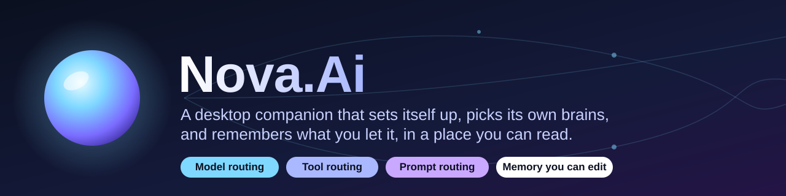
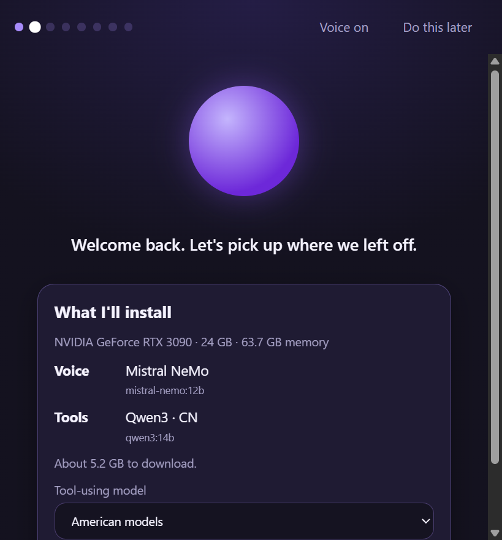
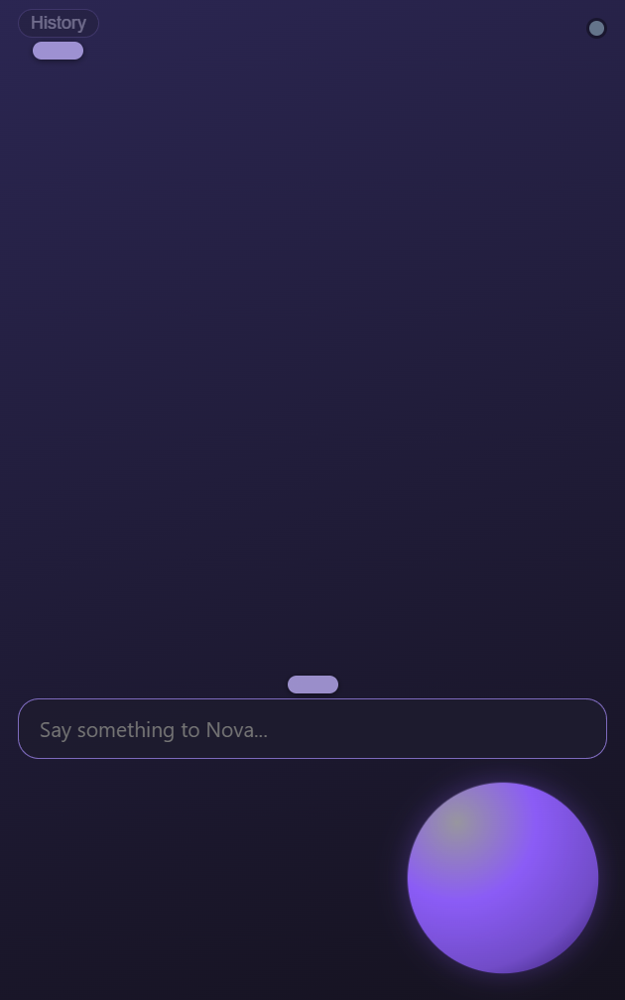
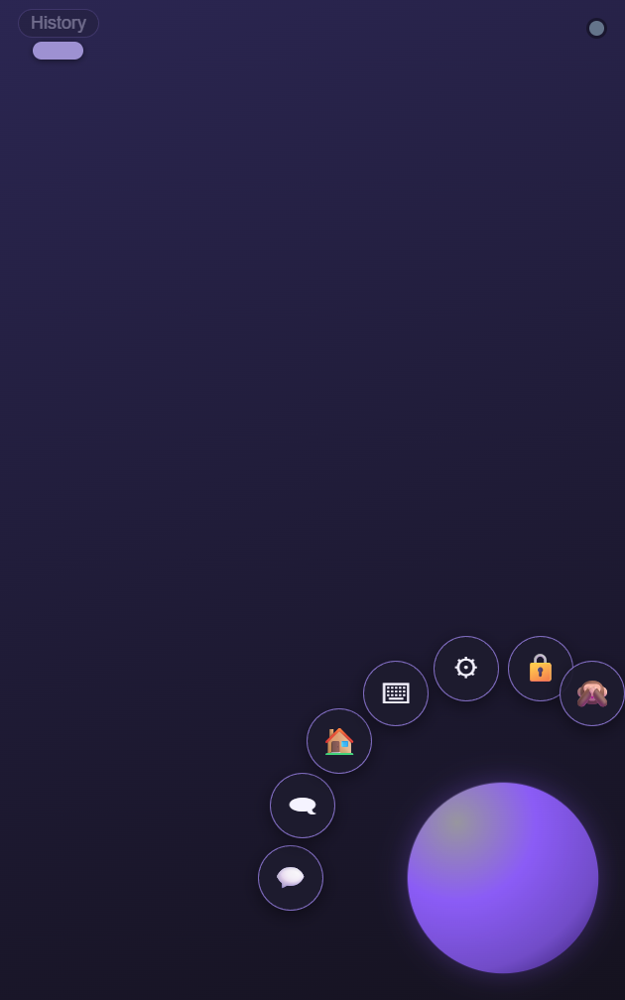

<p align="center"></p>

# Nova.Ai

Nova.Ai is a desktop companion: a small glowing orb that lives in the corner of your desktop (or your own VRM avatar), talks and listens, can look at your window when you ask, and sits beside a small chat window. This repository holds the whole thing: the desktop app (Electron, plain JavaScript) and its backend (Python, in [`backend/`](backend/README.md)). Where it is and where it is going: [ROADMAP.md](ROADMAP.md#timeline).



| The text box sits above the orb | The menu fans around the orb |
| --- | --- |
|  |  |

## What it does

- Transparent always-on-top orb (or avatar) that swells with her voice and takes the colour of her mood; click-through except over her. Right-click her for a radial menu.
- The display is optional: hide it (Ctrl+Alt+N, tray, radial menu) and Nova keeps running. A chat window (Ctrl+Alt+C) opens beside her and is placed from the same origin as the avatar, so dragging either moves both.
- Everything can be moved and locked: drag the small grip above the speech bubble, the text box and the buttons, the chat window by its title, or the orb itself. Double-click a grip to put that element back. Lock the layout from the radial menu, the tray or Settings > Display and nothing moves; "Reset layout" in the tray puts it all back.
- Voice in (wake word, push-to-talk style commands) and voice out, speech bubble, history drawer, thumbs and reactions.
- Notification centre, tray menus, a Home window that hosts the Nova web app, a Code window for the agent, GPU and training status.
- Settings panel for voice, listening, screen looks, display, chat mode, notifications and the agent.

## What makes it different

Most local AI apps hand you a model picker, a pile of settings and an empty chat box. Nova.Ai is built so a non-technical person never has to set any of that up, and so nothing it knows about you is hidden. Four ideas, with where each one stands today:

| | The idea | Today | Next |
| --- | --- | --- | --- |
| **Model routing** | She chooses her own models: one for conversation, one for tool calling, picked for your hardware, with the safety variant that fits your settings. A model that is missing or failing falls through to the next candidate. | Built (`backend/novaai/router.py`, `models.json`). Setup downloads what it picked. | Route by task (a bigger model for hard questions), learn from failures and speed, and show the user which model answered and why. |
| **Tool routing** | A tools model decides when a request needs a tool, runs it, and the voice model words the result. | Partly built: four tools (remember, recall, forget, the time), triggered by a short list of phrases. | Let the tools model decide instead of phrase matching, add timers, notes and screen looks behind plain-language on/off switches. |
| **Prompt routing** | Each turn gets the prompt pieces it needs (her personality, boundaries, the memories that matter, the current task) and no more. | One prompt shape for every message. | Choose pieces and context size per kind of turn, and log what was sent. |
| **Persistent memory you can edit** | What she learns about you is stored as plain sentences on your machine. You can read, correct and delete every one. | Built: facts are saved during setup, when you ask her to remember, and automatically after a turn (`learn.py`, with an off switch). A tray window, "What Nova remembers", lets you search, add, edit, delete (with undo), export and forget everything. Not yet tried with a real model or from the packaged app. | Summaries of old chats, and a "what she used for this answer" view. |

The rule behind all four: the app picks, the user can look. A "How she thinks" page will show, in plain words, which model answered, which tools ran and which memories were used, so none of the routing is a black box and none of it has to be configured. Two defaults go with it: setup installs [Ollama](https://ollama.com) silently if it is missing and tells you what it is doing as it goes, and everything stays on your machine. Cloud models are an opt-in you switch on in settings, never a default. See [ROADMAP.md](ROADMAP.md) for the order this is being built in.

## What you need

The desktop app is a client of the backend in this repository. It talks to it over a local WebSocket (`ws://127.0.0.1:8000`, protocol v1: `/api/desktop/ws`). The backend lives in [`backend/`](backend/README.md) in this repository: a small Python server that uses [Ollama](https://ollama.com) for models, with Mistral NeMo as her voice, a model router for tool calling, a harm filter you can turn off, and a guided, voiced onboarding. The installer carries a frozen copy of it (`novaai-server.exe`, built by `npm run build:backend`), which the app starts on its own at launch when nothing answers at the backend address and stops when it quits; its log is `logs/backend.log` in the app's data folder. Her voice (Kokoro on onnxruntime) and ears (Whisper on ctranslate2) are bundled too and need no torch; their model files (about 500 MB, the voice pack) are downloaded once during setup into `~/.novaai/voice`, and if that download fails she uses your computer's voice until you retry it (`novaai-server voicepack`, or `python -m novaai voicepack` from source). You still need [Ollama](https://ollama.com) for the models. From source, start it with `python -m novaai serve`; a backend you start yourself (or a start script) is never replaced by the bundled one.

## First run

On a fresh install the app opens a guided, voiced setup (`Set up Nova...` in the tray opens it again): she introduces herself, checks your machine, downloads her models with spoken progress, gets to know you in a real conversation (type, or use the microphone), lets you audition voices, explains the safety filter in plain words, and lets you keep the orb or choose your own `.vrm` avatar. On the desktop she is a small orb in the corner of the screen (about a tenth of the screen width, adjustable) that swells with her voice; the avatar is an option (Settings > Display > How I look). If no backend is running yet, the setup window says so and shows how to start it. If speech is not installed on the backend, she uses your computer's voice.

## Build and run

```
npm install
npm start          # builds with Vite, then launches Electron
npm test           # pure node tests, no Electron or backend needed
npm run dist       # Windows installer (electron-builder); builds the backend sidecar first
```

Backend tests (from `backend/`, with its own Python environment): `python -m pytest`. See [backend/README.md](backend/README.md).

Settings live in `settings.json` under the Electron user-data folder; environment variables such as `NOVA_BACKEND`, `NOVA_TTS` and `NOVA_VOICE_IN` override them (see `electron/settings.js`).

## Avatar

No avatar model ships with Nova.Ai: she is an orb. To use an avatar of your own, choose a `.vrm` file in setup ("Use my own avatar...") or Settings > Display, then set "How I look" to the avatar. `NOVA_VRM=<path to a .vrm file>` does the same for development.

## License

GPL-3.0-only, see `LICENSE`. No avatar model is distributed with this repository.

## History

The desktop app was split from the private Nova project with its commit history kept (`git subtree split` of `desktop/`); the backend was added to this repository on Oct 27, 2026.
